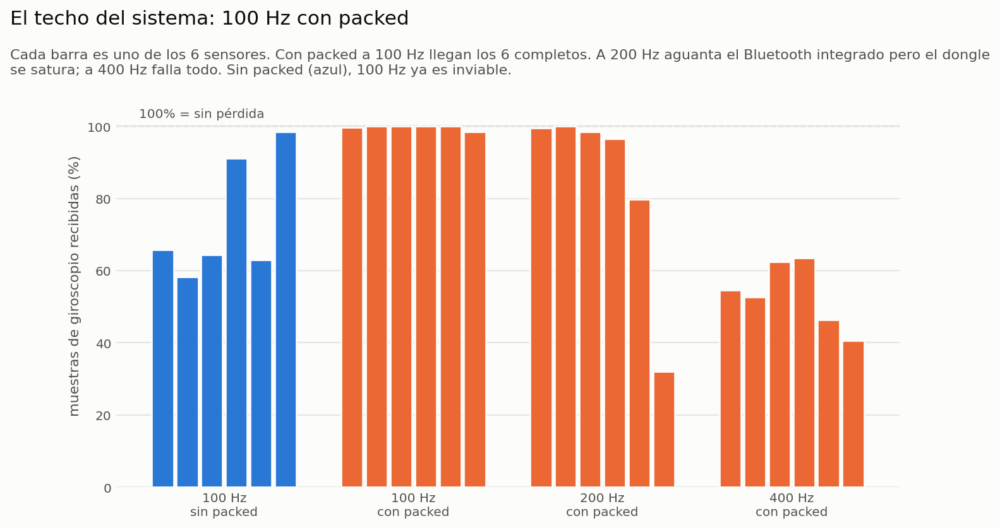

# 1. Caracterización de la plataforma

Pruebas de conectividad y de señal sobre la plataforma heredada: **6 sensores
MetaMotionRL** (acelerómetro y giroscopio BMI160) conectados por BLE a una
**Raspberry Pi 4B** (Bluetooth integrado + dongles USB). Sesiones del 14, 20,
21, 25 y 27 de agosto de 2026.

Salvo que se indique otra cosa: sensores en reposo junto a la Pi, intervalo
de conexión 30 ms, reparto entre adaptadores (`split`). Todo se midió con
`raspberry/acquire.py` y se analizó con `analisis_conectividad/`; las
bitácoras están en `datos/caracterizacion/`.

---

## 1.1 Revisión del sistema heredado

El repositorio original (`INDICATIC-AIP/metawear-data-collector`) tenía un
script de adquisición de ~400 líneas y nada de sincronización, OpenCap ni
análisis. Leído línea por línea contra el artículo y los bindings del SDK,
aparecieron cuatro problemas que condicionaban cualquier medición:

| # | Hallazgo | Consecuencia | Corrección en `acquire.py` |
|---|---|---|---|
| 1 | El script escribía una fila solo cuando tenía **a la vez** una muestra de acelerómetro y una de giroscopio, y las borraba al escribir. | Pérdida **de software**, silenciosa, que se confundía con pérdida del enlace. | Una fila por muestra, con su propio tiempo. |
| 2 | El número `hci0`/`hci1` que asigna Linux **se invirtió entre dos sesiones del mismo día**. | Las comparaciones "hci0 vs hci1" mezclaban adaptadores físicos. | Los adaptadores se identifican por tipo de bus (UART = integrado, USB = dongle). |
| 3 | Intervalo de conexión fijo en **7.5 ms**, el mínimo del estándar BLE. Cada evento de conexión ocupa ~2.5 ms: caben ~3 conexiones. | Es exactamente el "límite de 3 sensores por adaptador" que el artículo atribuía al hardware. | `--conn-interval`, 30 ms por defecto. **A 50 ms conectaron los 6 sensores en un solo adaptador** (a 7.5 ms, 4). |
| 4 | La configuración del sensor se escribía mientras el enlace renegociaba sus parámetros y fallaba en silencio. | "Conexiones fantasma": sensor conectado con 0 Hz y 100 % de pérdida. | Espera y verificación de que el sensor arrancó. |

Otros detalles que se resolvieron: el *segmentation fault* del SDK al cerrar
(pausa entre desconexiones y salida forzada), la pérdida de una corrida por
sacar una USB sin `sync` (`fsync()` al cerrar archivos) y el giroscopio
perdiendo ~3 veces más muestras que el acelerómetro bajo contención (por eso
la pérdida se reporta **por canal**, nunca combinada).

## 1.2 Resultados

### Número de sensores y reparto entre adaptadores

- **Escalera 1-6 sensores (14-ago, intervalo original):** el integrado aguanta
  4 sin fallos; el dongle falla al pedir el 4.º; el reparto 3+3 es el único que
  conecta los 6 (0.77 % de pérdida media).
- **Estabilidad (21-ago):** 10 corridas seguidas de 120 s con los 6 sensores,
  **0 fallos de conexión**.
- **El "sensor defectuoso" no existía.** La pérdida se concentraba en el
  **último puesto de la cola** de conexión de cada adaptador; al rotar el orden
  (`--rotate`), los picos se mudaron con la posición y no con el dispositivo
  (`figuras/fig1_posicion_vs_sensor.png`).
- **2+2+2 elimina el problema (25-ago).** Con tres sensores por adaptador el
  tercero de cada uno perdió 78.7 %, 34.0 % y 2.3 % en 3 de 5 corridas; con
  **dos por adaptador** (integrado + 2 dongles) la pérdida máxima fue **0.2 % en
  30 mediciones**.

### Frecuencia de muestreo y empaquetado (21-ago)

| Configuración | Giroscopio recibido | Lectura |
|---|---|---|
| 100 Hz sin packed | 58-98 % por sensor (pérdida 34-89 %) | inviable |
| **100 Hz con packed** | **> 97.5 % en los 6** | **configuración estándar** |
| 200 Hz con packed | integrado 98-100 %, dongle hasta 32 % | el cuello de botella es el dongle |
| 400 Hz con packed | 40-63 % | falla todo |

50 Hz vs 100 Hz (ambos con packed, 3 repeticiones × 6 sensores): 0.31 % vs
0.42 % de pérdida. 100 Hz entrega el doble de datos por 0.11 puntos más.



### Deriva (dos reposos de 15 min, 50 y 100 Hz)

- **Reloj: ~100 ppm** (−7 a −198 ppm según sensor), entre 50 y 100 veces menos
  que el 0.5-1 % que se venía asumiendo. Lo que se reportaba como deriva era
  pérdida de paquetes.
- **Orientación: sesgo constante del giroscopio**, 0.03 a 0.82 °/s según sensor
  y eje, reproducible entre sesiones. Se corrige midiendo unos segundos de
  reposo al inicio de cada toma (`figuras/fig4_drift.png`).

### Alcance y movimiento (21 a 27-ago)

- **Prueba de caminata del 21-ago: falló.** Con los sensores en el cuerpo y la
  Pi fija, los 6 enlaces murieron en menos de 20 s (`figuras/fig3_caminata_fallo.png`).
- Se probaron, por separado, cuatro arreglos: potencia de transmisión 0 → +4 dBm
  (`--tx-power`), *supervision timeout* 6 → 16 s (`--supervision`),
  reconexión automática y comparación de **tres dongles** (TP-Link con antena,
  TP-Link mini y genérico). Con la Pi fija el streaming se sostiene hasta
  **~2 m** y a 4 m sostenidos se cae. Llevar la Pi en la cintura del sujeto da
  ~20 dB de margen, contra 5.5 dB de subir la potencia.
- **Modo log:** cada sensor graba en su memoria y se descarga al final.
  **0.0 % de pérdida a 100 Hz**, sin un solo hueco en 228 s. Es el modo que se
  usó en todas las sesiones con OpenCap.

> Los CSV crudos de las pruebas no están en este repositorio porque ocupan
> cerca de 0.5 GB. Las bitácoras y los resúmenes sí están, en
> `datos/caracterizacion/`.

## 1.3 Configuración final

| Parámetro | Valor | Por qué |
|---|---|---|
| Modo | **log** (`raspberry/log.py`) | 0 % de pérdida aunque el sujeto se aleje |
| Reparto | **2+2+2** (integrado + 2 dongles) | la tercera conexión por adaptador es la que pierde |
| Frecuencia | 100 Hz, acelerómetro + giroscopio | techo medido en vivo; en log, probado sin huecos |
| Intervalo de conexión | 30 ms | 7.5 ms limita a ~3 conexiones |
| Supervisión / potencia | 16 s / +4 dBm | margen de enlace para la descarga |
| Magnetómetro | **no** | en interiores distorsiona; sin él, solo deriva el rumbo (ver doc. 3) |

## 1.4 Cómo reproducir los análisis

```bash
cd analisis_conectividad
pip install -r requirements.txt
python analizar_bandwidth.py   ../datos/caracterizacion/run_log_20-21ago.csv
python graficas_resultados.py  ../datos/caracterizacion/run_log_20-21ago.csv --outdir salida
```

Los demás scripts (`analizar_cobertura.py`, `analizar_drift.py`,
`analizar_nyquist.py`, `analizar_dongles.py`, `analizar_sync_imu_imu.py`)
trabajan sobre los CSV crudos de cada corrida; ver
`analisis_conectividad/README.md`.

| Bitácora | Contenido |
|---|---|
| `run_log_20-21ago.csv` | todas las tandas de caracterización (`base`, `orden`, `packed_test`, `odr_test`, `odr2`, `freq`, `drift_reposo`, `drift2`, `caminata`) |
| `run_log_25-27ago.csv` | primeras grabaciones en modo log |
| `bandwidth_summary.csv`, `resumen_por_adaptador.csv` | resumen por configuración y por adaptador |
| `resumen_drift.txt`, `resumen_caminata.txt`, `resumen_bandwidth.txt` | salidas completas de los análisis |
