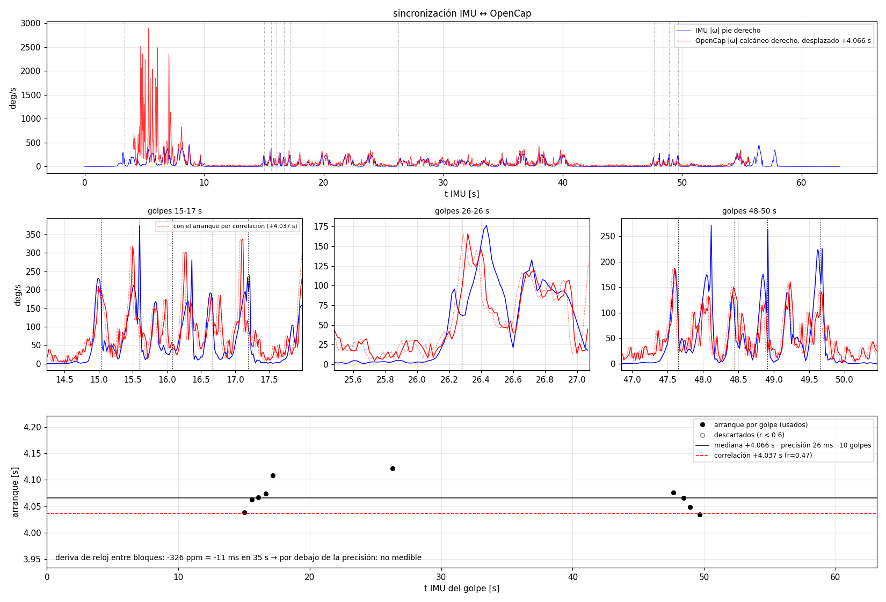
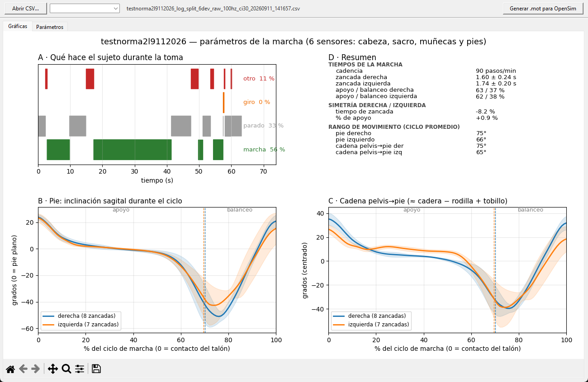

# 3. Procesamiento, parámetros de la marcha y validación

Todo el código está en `pc/`. El orden de las etapas y cómo correrlas está en
[`MANUAL_PIPELINE.md`](MANUAL_PIPELINE.md); acá va el método y lo que se
puede afirmar con él.

## 3.1 Sincronización IMU ↔ OpenCap

Los dos sistemas tienen relojes independientes (Raspberry Pi e iPhone).

1. **Correlación cruzada** de la velocidad angular del pie derecho entre los dos
   sistemas: da el arranque y sirve para verificar que una toma y un trial son
   la misma pasada (r ≈ 0.3 contra todos = no tiene par).
2. **Golpes de talón** (desde el 11-sep): cada golpe se localiza en el IMU y
   alrededor de cada uno se busca el desfase que mejor superpone las dos
   señales. La mediana es el arranque y **la dispersión entre golpes es la
   precisión: 26-27 ms**. Con golpes al inicio y al final, la deriva de reloj
   Pi–iPhone sale −11 ms en 35 s, por debajo de la precisión.

## 3.2 Orientación sin magnetómetro

La orientación de cada sensor se estima con **VQF** (Laidig y Seel, 2023) en
modo 6D. Contra OpenCap se midió que **el rumbo deriva ~1 °/s** sin
magnetómetro (57-66° en 59 s, igual en pelvis, pie y cabeza), diez veces más
de lo estimado al principio. Por eso el análisis usa **solo inclinaciones
referidas a la gravedad** (sagital y frontal de cada segmento), que el
acelerómetro ancla y no derivan. Nada que dependa del rumbo (rotación de
pelvis, ángulo de progresión del pie, trayectoria) se reporta.

## 3.3 Parámetros de la marcha

Se reutiliza la biblioteca de **Mythos MECH** (trabajo previo en Illinois
Institute of Technology, copia parcial en `pc/mythos_mech/`): eventos por
giroscopio (Aminian 2002, Salarian 2004), detección de giros desde el sacro y
parámetros temporales. `parametros_marcha.py` adapta los datos del montaje S
a esa biblioteca y agrega lo que el montaje de una pierna no permitía:

- **segmentación de la actividad** antes de medir nada (marcha / parado / giro
  / otro); los parámetros salen solo de la marcha en línea recta;
- **zancadas típicas**: en un pasillo corto la mitad de los ciclos son los
  pasitos de la vuelta; se separan por forma y duración;
- **simetría derecha/izquierda** (índice de Robinson, 0 % = simétrico);
- **segundo detector de eventos independiente** (ZUPT, pie plano).

**La cadena pelvis→pie** (inclinación del pie menos inclinación del sacro) es
lo único de la pierna que este montaje mide: equivale a
`cadera − rodilla + tobillo`, no a cada articulación.

### Lo que muestra la app (`pc/app_marcha.py`)

| Se muestra | Por qué |
|---|---|
| reparto de la actividad | sin esto ningún otro número se interpreta |
| cadencia, apoyo / balanceo | validados (ver 3.5) |
| zancada de las zancadas típicas | la de todas las zancadas mezcla los pasitos de las vueltas |
| simetría de zancada y de apoyo | cantidades medidas con los dos pies |
| ciclo promedio y rango del pie y de la cadena pelvis→pie | inclinaciones referidas a la gravedad, comparadas contra OpenCap |

| Se sacó de la app (sigue en el `.json` y en `--detalle`) | Por qué |
|---|---|
| CV y DE de la zancada sobre todas las zancadas | sale 20-40 % por las paradas y vueltas; **no es variabilidad de la marcha** |
| largo de zancada y velocidad por ZUPT | no confiables (0.85-0.99 m contra 1.2-1.5 m reales) |
| pelvis, cabeza y braceo | la pelvis de OpenCap no sirve de referencia (3.4) y el braceo sale con menos amplitud en el IMU |
| desfase entre los dos detectores | es un control interno, no un parámetro |

## 3.4 Comparación contra OpenCap

| Sesión | Magnitud | Acuerdo |
|---|---|---|
| 01-sep (5 tomas) | cadena sagital pelvis→pie | **r = 0.85 ± 0.04, RMSE 9.2 ± 1.6°** (literatura de arreglos reducidos: 4.8-18°) |
| 01-sep | inclinación de los pies | r = 0.89, RMSE 6.6° |
| 10-sep | pie derecho / izquierdo | r = 0.90 / 0.86 |
| 11-sep (`TEST2`) | cadena de brazo (hombro + codo) | r = 0.91 / 0.87, con menos amplitud en el IMU |

**La pelvis de OpenCap no es referencia en estas tomas:** su `pelvis_tilt`
deriva 25° en 12 s de marcha y se compensa casi exactamente con la columna
lumbar (r = −0.98); solo la suma (torso) es estable. El r ≈ 0.1 del sacro
contra ella mide ese artefacto del video sin marcadores, no al sensor.

## 3.5 Veredicto de validación: **válido con reservas**

| Capa | Qué incluye | Estado |
|---|---|---|
| **Medida** | eventos, cadencia, apoyo/balanceo, simetría, inclinaciones de segmento, cadena pelvis→pie | **validada** |
| **Reconstruida** | cadera, rodilla y tobillo por separado (documento 4) | correcta pero en paridad con el ciclo medio del sujeto; sirve para animar |
| **Estimada** | largo de zancada y velocidad por doble integración | **no usar** |

La prueba más fuerte de la capa medida **no depende de OpenCap**: el
porcentaje de apoyo dio **60.8 ± 1.1 % en seis tomas independientes**, contra
~60 % de la marcha normal (Perry y Burnfield). Si la detección de eventos
estuviera rota, ese número no saldría bien seis veces. Además, los dos
detectores de eventos (giroscopio y ZUPT) marcan eventos distintos (contacto
inicial y pie plano) con un desfase **consistente de +165 a +240 ms**, que es
lo que dura la respuesta de carga. Cadencia del 01-sep: 92.2 ± 4.2 pasos/min.

**Trampa a no pisar:** el CV del tiempo de zancada sobre todas las zancadas
sale 21-31 %. No es variabilidad de la marcha: el sujeto arranca y para todo
el tiempo. Reportarlo como marcador de riesgo de caída sería la conclusión
falsa más fácil de sacar de estos datos.

**Lo que limita todo es el conjunto de datos, no el método**: tomas cortas,
pasillo de 3 m y pocas zancadas en régimen (documento 2, §2.4).
