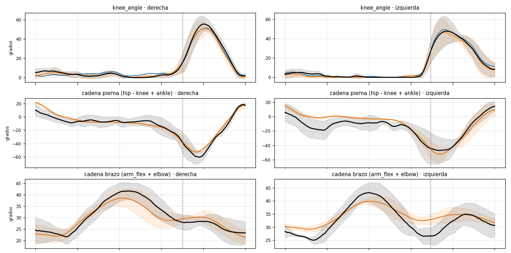

# 4. Integración con OpenSim: los tres archivos de movimiento

Para ver los datos de los sensores sobre un **modelo musculoesquelético
tridimensional** se generan tres `.mot` con las mismas 33 coordenadas del
modelo `LaiUhlrich2022` que usa OpenCap. Los tres se abren igual:

1. OpenSim → `File > Open Model…` → `LaiUhlrich2022_scaled.osim` **de la misma
   sesión** (está escalado a ese sujeto).
2. `File > Load Motion…` → el `.mot`.
3. Play. Cargando los tres del mismo trial uno tras otro se ve la diferencia.

Los de la sesión del 11-sep ya están generados en
`resultados/sesion_2026-09-11/2_para_opensim/`.

| Archivo | Qué es | Programa |
|---|---|---|
| `TEST2.mot` | **OpenCap puro**: video sin marcadores. La referencia. | export de OpenCap |
| `<toma>_opencap_mas_imu.mot` | **OpenCap + IMU**: las cadenas de pierna y brazo medidas por los sensores reemplazan a las del video | `pc/fusionar_mot.py` |
| `<toma>_opencap_mas_imu_con_pelvis.mot` | lo mismo, más la inclinación de pelvis del sacro | `pc/fusionar_mot.py --canales cadena,brazos,pelvis` |
| `<toma>_reconstruido.mot` | **solo IMU**: la caminata completa generada desde los 6 sensores | `pc/reconstruir_toma.py` (o el botón de la app) |

## 4.1 OpenCap + IMU (`fusionar_mot.py`)

Parte del `.mot` de OpenCap y **le incrusta solo lo que el sensor mide**:

- **pierna**: la suma `cadera − rodilla + tobillo` = inclinación del pie menos
  la del sacro. La diferencia con OpenCap se reparte entre cadera y rodilla
  conservando la suma y respetando el rango del modelo;
- **brazos**: `arm_flex + elbow_flex` = inclinación de la muñeca, repartida
  entre hombro y codo;
- **pelvis** (solo `_con_pelvis`): inclinación sagital y frontal del sacro,
  descontada de lumbar y caderas para conservar el torso y los muslos que el
  video sí ve;
- **nunca**: rotación de pelvis, traslaciones, tobillo aparte, subtalar,
  rotaciones de brazo. El montaje no las mide.

Sin pose estática el sensor mide bien la forma de la onda pero no su cero:
cada señal se lleva a la mediana de la de OpenCap antes de escribirla.

## 4.2 Solo IMU (`reconstruir_toma.py`)

El montaje no tiene sensores en muslo y pierna, así que cadera, rodilla y
tobillo no se pueden medir. Sí se pueden **reconstruir**: con los `.mot` de
OpenCap del propio sujeto se arma un modelo de baja dimensión de su marcha
(análisis de componentes principales por ciclo, la "variedad de marcha"), y
se busca la combinación que mejor explica lo que los sensores miden sin
deriva (la cadena pelvis→pie y la inclinación de pelvis). Es una estimación
regularizada en forma cerrada, sin entrenamiento.

| Coordenadas | Origen |
|---|---|
| `pelvis_tilt`, `pelvis_list`; suma cadera − rodilla + tobillo; cadencia y ciclos | **medido** |
| `hip_flexion`, `knee_angle` | la suma es medida; el reparto lo decide el modelo |
| tobillo, aducción/rotación de cadera, lumbar, brazos | generados de la marcha del sujeto |
| `pelvis_tx` | sintetizado por la cadencia, siempre en línea recta (sin rumbo) |

**Resultado honesto** (dejando fuera la toma que se reconstruye):

| | ciclo medio del sujeto | reconstrucción | |
|---|---|---|---|
| rodilla, 01-sep (5 tomas) | 12.5° | 12.2° | +3 % (paridad) |
| **rodilla, 10-sep** (marcha continua, variedad de otro día) | 14.9° | **11.3°** | **+24 %** |
| cadera / tobillo | — | — | paridad |

La mejora en la rodilla apareció solo cuando hubo marcha continua: el dato
pesó más que el método. **Sirve para animar la caminata en OpenSim; no es una
medición de rodilla ni de cadera.** (`pipeline.py` y la app usan la variedad
de la sesión completa, `--sin-excluir`, porque el fin es la animación.)

## 4.3 Comparación de los tres `.mot` (`comparar_mot.py`)

Los tres archivos se cortan en **los mismos ciclos** (contacto inicial
detectado por el IMU y llevado al tiempo de OpenCap), solo zancadas típicas en
los dos sistemas. Como las versiones "+IMU" parten de OpenCap, en lo que el
sensor no toca la diferencia es 0, y en lo que sí toca la diferencia **es el
aporte del sensor**.

*Negro: OpenCap. Azul: OpenCap + IMU. Naranja: OpenCap + IMU con pelvis.*

**TEST2** (5 zancadas por lado):

| | OpenCap | +IMU | +IMU+pelvis |
|---|---|---|---|
| rodilla der, rango | 56 ± 8° | 53 ± 6° (r 0.98, RMSE 4°) | 52 ± 7° (**r 0.99, RMSE 3°**) |
| rodilla izq, rango | 54 ± 5° | 56 ± 3° (r 0.98, RMSE 4°) | 53 ± 4° (**r 0.99, RMSE 3°**) |
| cadera der, rango | 40 ± 8° | 46 ± 9° (r 0.93) | 46 ± 5° (r 0.86) |
| cadena pierna der / izq | 82 ± 9° / 72 ± 11° | 76 ± 4° (r 0.90) / 73 ± 6° (r 0.80) | igual |
| brazo der / izq | 24 ± 6° / 20 ± 3° | 20 ± 7° (r 0.91) / 12 ± 2° (r 0.87) | igual |
| pelvis tilt, rango | 15 ± 6° | igual | 9 ± 1° |

**TEST1_1** (3 zancadas por lado, marcha lenta; OpenCap tiene un salto en
t = 15.8 s dentro de esos ciclos): rodilla der r 0.98 / RMSE 3° con la pelvis
del sensor; brazo derecho casi sin braceo (8° en el IMU).

Lectura: la **rodilla** es lo mejor del montaje. La cadera de OpenCap tiene
mucha dispersión entre ciclos porque arrastra su pelvis; el sensor la baja. El
**brazo** sale con la misma forma pero menos amplitud en el IMU: es el eje de
la muñeca, y lo arregla la calibración funcional que no se hizo.

## 4.4 OpenSense

`analizar_toma.py` también escribe `<toma>_orientations.sto` con los
cuaterniones de cada sensor para OpenSense. Sin una pose estática al inicio de
la toma, el IMU Placer no puede registrar los sensores sobre el modelo, así
que ese archivo **no es utilizable todavía**. El flujo IMU → OpenSense →
animación lo continuó el compañero de pasantía en las semanas 5 y 6, con
sesiones grabadas con la fusión de orientación del propio sensor.
